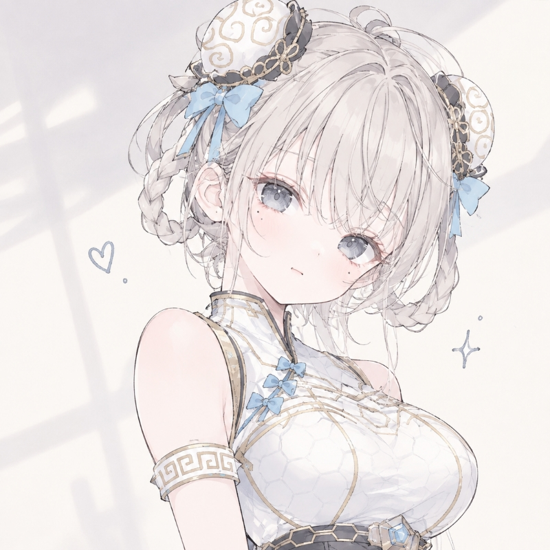

# HNS Skin System · v4.0.0 (Official Release)

> Counter-Strike 1.6 / AMX Mod X · standalone custom skin system for **GTR HNS** (Hide & Seek) servers.



**HNS Skin System v4.0.0** is the new standalone release of the `HnsSkin` plugin series. It replaces the old `HnsMatchSkin` plugin on `main` and no longer shares the match plugin's `mixsystem` configs, database or coin table.

## What's new in v4.0.0

- 🌍 **English by default, 4 languages included** — English, 简体中文, 繁體中文, Русский.
  A player whose client language is not `cn` / `tw` / `en` / `ru` is switched to English 2 seconds after connecting.
  Players who pick a language manually with `/lang` keep their own choice.
- 🗂 **Redesigned menus** — character skins (TT / CT separated), knife models, grenade models (smoke / flash), GBIC points, smoke color, MySQL status and the admin panel are now separate entries. `/skin` stays the single entry point.
- 🔁 **Deathmatch team-switch follow** — in deathmatch, when a player is knifed and swapped to the other team without respawning, the plugin detects the new team within one second and applies that side's skin and knife automatically. No respawn required.
- 💾 **Own database and currency** — uses its own SQLite / MySQL storage and its own GBIC points; never reads the match plugin's `mixsystem` or coin table.
- 🛠 **Install-and-go package** — compiled `.amxx` files, full source, includes and example configs are all included.

## Languages

| Language | Documentation |
|---|---|
| 🇬🇧 English | [README.md](README.md) |
| 🇨🇳 简体中文 | [README.zh-CN.md](README.zh-CN.md) |
| 🇹🇼 繁體中文 | [README.zh-TW.md](README.zh-TW.md) |
| 🇷🇺 Русский | [README.ru.md](README.ru.md) |
| 🇰🇷 한국어 | [README.ko.md](README.ko.md) |
| 🇯🇵 日本語 | [README.ja.md](README.ja.md) |

The plugin language file is [`addons/amxmodx/data/lang/hns_skin.txt`](addons/amxmodx/data/lang/hns_skin.txt) with `[cn]`, `[tw]`, `[en]` and `[ru]` sections. The `README.*` files are documentation only; the in-game default is English.

## Quick Start

1. Merge `addons/` into your server's `cstrike/addons/` directory.
2. Make sure the load order in `configs/plugins.ini` is:

   ```
   CustomPlayerModelsApi.amxx
   HnsSponsorLocal.amxx
   HnsSkin.amxx
   ```

   `crx_knife_models.amxx` (optional, for knife skins) must be loaded **before** `HnsSkin.amxx`.
3. Do **not** load the old `HnsMatchSkin.amxx` at the same time — both register `/skin`.
4. Enable the `sqlite` module in `modules.ini`; points and daily check-in need `nvault`.
5. Change map or restart the server.

Chinese install guide: [`docs/安装说明.txt`](docs/安装说明.txt).

## Feature Highlights

- **Local SQLite by default, MySQL optional** — works out of the box with no database setup; switch to MySQL to share data across multiple servers
- **Unlimited skins** — add as many as the model precache limit allows
- **TT / CT separated** — each skin belongs to one team; players only see and buy the skin of their current team
- **Rental + permanent** — coin purchase grants a 30-day rental (configurable); upgrade it to permanent with coins; admin grants are permanent
- **Death sound per skin** — each skin can carry one or more death sounds, randomly picked on death
- **Knife / grenade skins** — knife models via `crxknives`, smoke and flash models via `nade_skins.cfg`
- **Daily check-in and playtime rewards** — GBIC economy fully inside the skin system
- **Precache guard** — `precache_max` protects heavy HNS maps from the CS 1.6 512-model limit
- **Background grant** — `cpm_skin_grant` lets you grant skins to offline players directly from HeidiSQL / phpMyAdmin

## Repository layout

```
hns-skin-system/
├── addons/amxmodx/              # deployable package
│   ├── plugins/                 # compiled .amxx (3 plugins)
│   ├── scripting/               # source + include/
│   ├── configs/                 # plugins.ini, KnifeModels.ini, skinsql/, custom_player_models.cfg
│   └── data/lang/hns_skin.txt   # cn / tw / en / ru language file
├── docs/                        # installation guide (Chinese)
├── assets/                      # author avatar
├── versions/                    # legacy releases (v1.0.0 ~ v3.1.0)
├── CHANGELOG.md
├── LICENSE                      # GPLv3
└── README.*.md                  # multilingual documentation
```

## Commands

| Command | Access | Description |
|---|---|---|
| `/skin` | everyone | skin shop: character / knife / grenade / points / smoke color |
| `/lang` | everyone | switch language (cn / tw / en / ru) |
| `/sign` | everyone | daily check-in (`/checkin`, `/qd`, `/签到` also work) |
| `/cpm` | ADMIN_RCON | admin menu: pool, ownership, grant, remove, clear |
| `amx_giveskin <steamid> <skin\|all\|all_t\|all_c\|all_knife\|all_nade>` | ADMIN_IMMUNITY | grant skins to an online or offline player |
| `amx_takeskin <steamid> <skin\|all\|all_knife\|all_nade>` | ADMIN_IMMUNITY | remove skins |
| `amx_clearskin <steamid>` | ADMIN_IMMUNITY | clear all skins of a player |

## Configuration

| File | Purpose |
|---|---|
| `configs/skinsql/skins.cfg` | skin pool, `[SETTINGS]` block, `storage local/mysql` |
| `configs/skinsql/nade_skins.cfg` | smoke / flash grenade skins |
| `configs/skinsql/knife_skins.cfg` | knife shop prices |
| `configs/skinsql/skinsql.cfg.example` | MySQL connection template |
| `configs/KnifeModels.ini` | knife first-person / third-person models and sounds |
| `configs/custom_player_models.cfg` | player model engine cvars |

Default database is local SQLite at `addons/amxmodx/data/sqlite3/skinsql.sq3`; tables are created automatically. To use MySQL, copy `skinsql.cfg.example` to `skinsql.cfg`, fill in the credentials and set `storage mysql` in `skins.cfg`.

### Storage: local SQLite / MySQL

Both are supported; local is the default.

| Mode | `storage` | Details |
|---|---|---|
| **Local SQLite (default)** | `local` | File `addons/amxmodx/data/sqlite3/skinsql.sq3`; only the `sqlite` module is required, tables are created automatically. Best for a single server; back up by copying the `.sq3` file |
| **MySQL** | `mysql` | Copy `skinsql.cfg.example` to `skinsql.cfg`, fill in the credentials; tables are created automatically. Servers sharing the same database share purchases, current skins and smoke colors |

Stored data: `cpm_skins` (catalog), `cpm_player_skins` (owned / expiry), `cpm_player_current` (current selection), `cpm_skin_grant` (offline grant queue), `cpm_daily_checkin` (check-in), `cpm_smoke_color` (smoke color). Day-to-day changes only need `skins.cfg`; it is synced to the database on map change.

### Adding character skins (third-person body model)

1. Put the model at `cstrike/models/player/<folder>/<folder>.mdl`; the folder name must match the `.mdl` name (textures stay in the same folder).
2. Add one line under `[T]` or `[CT]` in `skins.cfg`:

   ```
   [T]
   北极战士  models/player/arctic/arctic.mdl  0
   wav skin/arctic_die1.wav
   wav skin/arctic_die2.wav

   [CT]
   德国GSG9  models/player/gsg9/gsg9.mdl  500
   ```

   Format: `name  model path  price`. The name is the unique key — never rename it after players buy it. A `wav` line belongs to the skin above it; multiple `wav` lines (or comma-separated paths) are picked at random on death.
3. Apply on map change, or `/cpm` → MySQL status → **Resync skin catalog**.

Character skins change the **third-person body** only (what other players, spectators and third-person cameras see). CS 1.6 cannot replace your own first-person arms/weapon with a player model.

### First-person / third-person weapon models

CS 1.6 uses three model prefixes:

| Prefix | View | Meaning |
|---|---|---|
| `v_` | first person | the model in your own hands |
| `p_` | third person | the model other players / spectators see |
| `w_` | world | the model lying on the ground / in the world |

**Knives** — `configs/KnifeModels.ini`:

```
[爪子刀女手]
V_MODEL = models/v_knife4.mdl    ; first person
P_MODEL = models/p_knife4.mdl    ; third person
PRICE   = 300                    ; 0 = free
```

- `V_MODEL` only → you see the new knife, others see the stock `p_knife.mdl`.
- Both → both views use the new knife.
- Empty or missing file → fall back to `v_knife.mdl` / `p_knife.mdl`.
- The section name must match `knife_skins.cfg` for the price override to apply.

**Grenades** — `configs/skinsql/nade_skins.cfg`, one line each:

```
my_smoke  nade/v_smoke_blue  500  smoke
my_flash  nade/v_flash_gold  300  flash
```

Use the `v_` path; the plugin automatically looks for `p_xxx.mdl` (third person) and `w_xxx.mdl` (world) in the same folder and precaches them if present. With only `v_`, the first person changes and the other views stay stock.

### Sounds (custom third-party WAVs)

Two sound systems are configurable:

1. **Per-skin death sound** — `wav` lines in `skins.cfg` (see above).
2. **Per-knife sounds** — `*_SOUND` keys under a knife section in `KnifeModels.ini`:

   ```
   SELECT_SOUND  = knife/select.wav     ; selecting in the shop
   DEPLOY_SOUND  = knife/deploy.wav     ; drawing the knife
   SLASH_SOUND   = knife/slash.wav      ; light attack
   STAB_SOUND    = knife/stab.wav       ; heavy stab
   HIT_SOUND     = knife/hit.wav        ; hitting a player
   HITWALL_SOUND = knife/hitwall.wav    ; hitting a wall
   SELECT_MESSAGE = selected message (color codes allowed)
   ```

File placement and format:

- Put files in `cstrike/sound/<folder>/<file>.wav`.
- In the config write the path **relative to `sound/`**, without the `sound/` prefix:
  file `cstrike/sound/skin/miku.wav` → `wav skin/miku.wav`.
- Use PCM WAV (16-bit mono, 11025 or 22050 Hz recommended). `precache_sound` / `emit_sound` in CS 1.6 do **not** play MP3, so do not use `.mp3` for event sounds.
- Use lowercase ASCII names without spaces.
- All models and sounds are precached at map start. Clients need the files too: mirror them on FastDL (`FastDL/sound/...`, `FastDL/models/...`) or allow `sv_allowdownload 1`.

For a Chinese step-by-step guide, see [`docs/安装说明.txt`](docs/安装说明.txt).

## Legacy releases

`versions/` keeps all previous releases for history:

- `v3.1.0` — the old `HnsMatchSkin` main-branch addons, SQL schema and install docs (archived in this release)
- `v3.0.2`, `v3.0.0`, `v2.02`, `v2.01`, `v2.0.0`, `v1.1.0`, `v1.0.0`, `match-skin-v5`, `ic-v1.0.0`, `skin-1.0`

## License

GPLv3 — see [LICENSE](LICENSE).
